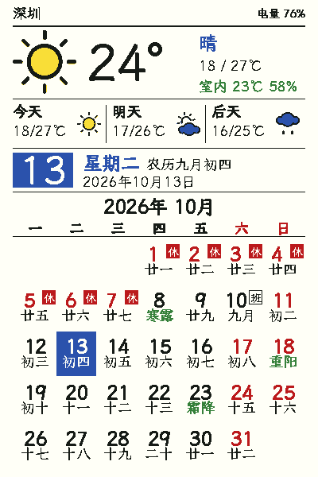

# PaperColor 六色天气日历

ESP-IDF 6.1 原生 C 固件，面向 M5Stack PaperColor：400×600 竖屏、QWeather 天气图标、公历／农历、月历与中国大陆放假调休。官方组件仅用于协议参考，不作为依赖。



预览使用模拟天气和理想色值；实际墨水屏色彩、方向及可读性需要实机确认。

界面先由 ImageGen 生成视觉参考，再在 Sketch 中按 400×600 重建为可编辑图层。参考图、最终 Sketch 文件及其导出图位于 `docs/design/`；固件坐标以 `papercolor-ui-v3.sketch` 为准。Sketch 中的天气图标直接导入随项目保存的 QWeather 官方 SVG，没有使用自绘占位图标。

## 构建与刷机

本机使用 EIM 安装的环境；常规安装可先运行对应 ESP-IDF 的 `export.sh`。

```sh
. ${HOME}/.espressif/tools/activate_idf_v6.1.sh
idf.py -B build-calendar build
idf.py -B build-calendar -p /dev/tty.usbmodem213101 flash monitor
```

替换串口为实际设备，使用 Ctrl+] 退出监视器。`build-calendar/` 与原有 `build/` 分开，避免清除原始构建。VS Code 的 clangd 已指向新编译数据库。

配置开启 16 MB Flash、8 MB Octal PSRAM，分区为 256 KB NVS 和单应用分区，无 OTA。升级已有其他固件时，分区布局会改变；刷机前保留原固件与配置备份。程序不会在 NVS 初始化失败时自动擦除数据。

六色色块和中文硬件测试：`idf.py -B build-calendar menuconfig` → **PaperColor calendar** → 启用 **Display six-color hardware test**，重新构建刷机；完成后关闭该选项。

## 首次配置

1. 启动后或长按顶部 **C** 三秒，设备进入配置模式。
2. 手机连接开放热点 **PaperColor-Setup**，无需密码。
3. 若系统弹出网络配置页可直接使用；否则在浏览器打开 **http://192.168.4.1**（必须使用 HTTP，不能使用 HTTPS）。连接 2.4 GHz 家庭 Wi-Fi，再填写和风天气控制台提供的 **API Host**（仅域名）和 **API Key**。
4. 搜索并选择中国大陆城市／区县，验证天气并保存。城市保存 Location ID 与经纬度；天气使用当前 v1 经纬度接口。
5. 保存成功后退出配置并更新屏幕；也可以按顶部 C 退出。十分钟无请求会自动退出。

保留相同家庭 Wi-Fi／API Host 时，密码／凭据留空沿用原值。更改家庭 Wi-Fi 名称后空密码表示开放网络。配置期间手机应继续连接 **PaperColor-Setup**；设备连接家庭 Wi-Fi 时热点可能变换信道，手机断开后需要重新连接。

家庭 Wi-Fi 密码与 API 密钥保存在 NVS，不返回配置页、不写入日志。配置 HTTP 服务不做额外鉴权；开放热点和服务只在配置模式运行，十分钟无操作自动退出。设备天气请求使用证书校验的 HTTPS，禁用自动重定向。NVS 当前未启用加密，不应将本固件视为已完成量产安全加固。

## 按键与更新

| 位置 | 按钮 | 短按 | 长按三秒 |
| --- | --- | --- | --- |
| 顶部 | C / GPIO1 | 回到今天并更新 | 进入配置 |
| 侧边上方 | A / GPIO10 | 上月 | 无操作 |
| 侧边下方 | B / GPIO9 | 下月 | 无操作 |

30 ms 消抖，800 ms 内翻月合并。刷新期间继续采集按键，C 清除已有翻月请求，配置请求优先。浏览时天气和大日期仍代表今天；五分钟后回到本月。电源按钮保留硬件原有行为。

整点、午夜、上电或手动触发更新；联网窗口最多 60 秒。屏幕刷新约 15–30 秒，成功且画面变化时更新，完成后断开 Wi-Fi、关闭屏幕／音频／SD／RGB／Grove 相应电源并深度睡眠。RTC 定时 IRQ 与三键唤醒，ESP 定时器作为备用唤醒源。续航需测量后评估。

网络失败保留天气缓存并标记离线；超过三小时标记过期，旧预报显示实际日期，避免将昨天标成今天。切换城市不会显示旧城市天气。RTC 无有效时间时显示等待校时，不编造日期。电量百分比是基于电压的粗略估计。

## 室内温湿度与状态灯

板载 SHT40 在每次唤醒、联网和点亮 RGB 之前测量，减少自热影响；保持唤醒超过十分钟时重新测量。天气区右栏以绿色显示“室内 23℃ 58%”，取整显示以避免细小变化触发整屏刷新；读取或 CRC 失败时显示“室内 --”。PaperColor 机壳内测量值可能略高于房间实际温度。

两颗 RGB 灯（G21，M5PM1 LDO 供电）亮度较低，深度睡眠前关闭 LDO。整点等无人值守唤醒只显示电量警告，夜间保持黑暗；上电和按键唤醒显示完整状态。

| 状态 | 颜色 |
| --- | --- |
| 上电开机 | 绿色约 1.5 秒 |
| 联网更新天气 | 蓝色常亮 |
| 屏幕刷新中 | 黄色常亮 |
| 配置模式 | 紫色闪烁 |
| 进入休眠（关机） | 白色渐暗熄灭 |
| 电量 ≤20% | 第二颗灯每 2 秒红色短闪 |
| 电量 ≤5% | 两颗灯红色快闪，覆盖其他状态 |

## 农历和节假日

农历资源覆盖 **2000–2099** 年，支持闰月与除夕；传统节日与放假安排独立。二十四节气按北京时间预先计算（`main/generated/terms.bin`），月历中以绿色显示，与传统节日同日时优先显示节日，今日信息行两者都显示。月历周一开头、最多六行，红色“休”表示放假区间、黄色“班”表示补班；普通周末不标“休”。

内置 [holidayAPI.json](https://raw.githubusercontent.com/lanceliao/china-holiday-calender/master/holidayAPI.json) 的 2023–2026 年快照。未来通过配置页上传同格式 JSON（最多 60 KB），无需重刷固件。结构示例：

```json
{
  "Timezone": "Asia/Shanghai",
  "Years": {
    "2026": [{
      "Name": "元旦", "StartDate": "2026-01-01", "EndDate": "2026-01-03",
      "Duration": 3, "CompDays": ["2026-01-04"]
    }]
  }
}
```

导入检查日期、年度、区间长度、重复项及休／班冲突；失败保留旧表。导入以完整表替换，不与旧表合并。文件缺少当年数据时提示“本年度调休数据未导入”；跨年放假区间仍可以匹配实际日期。第三方年度表应与国务院通知核对；设备不自动下载该地址。

## 天气图标

采用 [QWeather Icons](https://github.com/qwd/Icons) 1.8.0，固定提交与源文件校验值见 `main/generated/icons-manifest.json`。官方轮廓／填充字形离线转换为 112 px 主图标以及 20／30 px 预报图标，按天气代码精确匹配，未知代码使用 `999`；不再使用自绘天气图形。保留官方比例，填充适配六色、轮廓保持高对比度。

图标 © QWeather，采用 [CC BY 4.0](https://creativecommons.org/licenses/by/4.0/)，本项目进行了位图转换及六色重着色，原始字体、映射、署名和授权文本随项目保留。

## 字体与资源生成

中文采用 [霞鹜文楷 Lite](https://github.com/lxgw/LxgwWenKai-Lite) Regular 与 Medium。原始 TTF 保存在 `assets/fonts/source.ttf` 和 `assets/fonts/source-medium.ttf`，SHA-256 和字库大小见 `main/generated/manifest.json`。固件仅嵌入派生的 **PaperCalendarBitmap** 压缩单色位图字库，不在设备上解析 TTF。保留 OFL 授权和 Reserved Font Name 要求。

```sh
python3 -m venv .venv
.venv/bin/pip install -r tools/requirements.txt
.venv/bin/python tools/generate_assets.py
.venv/bin/python tools/generate_icons.py
.venv/bin/python tools/run_host_checks.py
```

字号为 14／18／24 px，48／64／88 px 仅含数字与符号。18 px 包含源字体内 GB2312 汉字，14／24 px 按固定界面和天气词汇裁剪。18／24 px 另有 Medium 字重位图（`font*m.bin`），用于城市名、天气描述和室内温湿度；其余关键标题仍使用 Regular 位图的像素加粗绘制。日历节日名只做横向 1 px 加粗：18 px 下“重”等字没有空间容纳更粗的横画。缺字显示 `?`。资源生成依赖固定版本 Pillow、fonttools、lunar-python；已生成资源随项目保存，常规固件构建不需要这些 Python 包。

## 测试与结构

`main/board.c`：原生屏幕／电源／RTC／SHT40；`led.c`：RGB 状态灯；`buttons.c`：消抖与请求合并；`calendar.c`：公历、农历和年度表；`data.c`／`network.c`：天气解析及联网；`compression.c`：有界 Gzip 解压和校验；`storage.c`：NVS；`setup.c`／`web/`：配置服务；`render.c`：六色绘制；`M5PaperColor.c`：生命周期与睡眠。

主机测试直接编译实际可移植 C 模块，使用 AddressSanitizer／UndefinedBehaviorSanitizer，检查日期转换、闰月、除夕、跨年假期、补班、坏年度表、天气解析、按键合并、损坏 Gzip 和字库完整性，并输出 `docs/previews/` 图片。当前脚本面向 macOS（Mach-O 资源嵌入）；Gzip 主机测试用 zlib，设备使用 ESP32-S3 ROM miniz。

```sh
python3 tools/preview_server.py
# 浏览 http://127.0.0.1:8765，使用模拟配置接口，不控制设备。
```

本地构建、逻辑测试和预览不能证明实机刷新／唤醒、真实和风天气账户权限或电池续航。本地验证记录见 [VALIDATION.md](docs/VALIDATION.md)。实机检查步骤见 [HARDWARE_CHECKLIST.md](docs/HARDWARE_CHECKLIST.md)，来源与授权见 [REFERENCES.md](docs/REFERENCES.md)。
